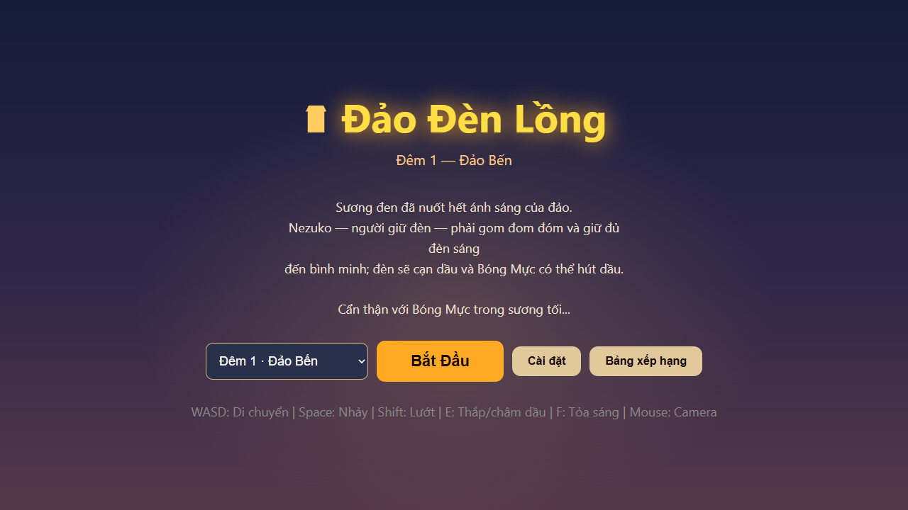

# Đảo Đèn Lồng — Phase 4 / Contract v1.3

Game sinh tồn 3D trên trình duyệt: thắp và châm dầu đèn, tránh Bóng Mực, giữ ít nhất 60% số đèn sáng cho tới bình minh. Giao diện dùng hình khối 2D, không phát nhạc nền.



[▶ Xem video demo Phase 4](docs/demo/demo.mp4)

## Yêu cầu hệ thống

- Windows, macOS hoặc Linux; trình duyệt desktop WebGL hiện đại.
- Node.js 20 trở lên và npm.
- Benchmark yêu cầu Chromium của Playwright: chạy `npx playwright install chromium` một lần.

## Cài đặt và chạy

```bash
npm install
npm run dev
```

Mở `http://localhost:5173/public/index.html`.

## Điều khiển

Mặc định: WASD di chuyển, Space nhảy, Shift lướt, E tương tác, F Tỏa Sáng, Esc tạm dừng, chuột xoay camera. Trong Cài đặt có thể gán lại từng phím, khôi phục mặc định, bật chữ lớn, giảm chuyển động và bảng màu dễ phân biệt.

## Kiểm tra, headless, benchmark và soak

```bash
npm test
npm run test:browser
npm run build
node src/headless.js --seed 42 --night 1 --ticks 14400 --out out.jsonl
npm run soak -- --seed 7 --nights 10 --out soak.json
npm run bench -- --seed 42 --duration 30 --out bench.json
npm run demo:record
```

Headless hỗ trợ `--night 1|2|3`, `--scenario`, `--inputs` và `--export-leaderboard out.json`. Để xuất bảng xếp hạng trong game, mở menu Bảng xếp hạng và bấm **Xuất leaderboard.json**; đặt file đó ở thư mục gốc trước khi gọi lệnh export. Bảng xếp hạng trong game được lưu trong localStorage của trình duyệt.

Benchmark mặc định mở cửa sổ Chromium 1280×720 (không toàn màn hình), tắt giới hạn tốc độ khung hình/vsync và chạy scene 200 Bóng Mực/100 đom đóm; cài browser một lần với `npx playwright install chromium`. Trên máy không có desktop, thêm `--headless`; chế độ đó dùng SwiftShader và không phản ánh hiệu năng GPU. `peak_mem_mb` để `null` vì runner web không đọc được RSS tiến trình Chromium một cách tin cậy. Số đo cục bộ chỉ tham khảo; máy chấm đo lại trên phần cứng chuẩn.

## Tài liệu

- Hợp đồng và lệnh: [game.contract.json](game.contract.json)
- Thay đổi Phase 1–4: [CHANGELOG.md](CHANGELOG.md)
- Nguồn asset và license: [CREDITS.md](CREDITS.md), [LICENSE](LICENSE)
- Ghi chú quyết định Phase 3: [ADR-003](docs/adr/ADR-003-lantern-fuel-and-dawn.md)
- Bằng chứng Phase 3/4: [docs/proof](docs/proof/)
- Retro: [docs/notes/retro.md](docs/notes/retro.md)
- Số liệu máy này: [bench.json](bench.json), [soak.json](soak.json)
